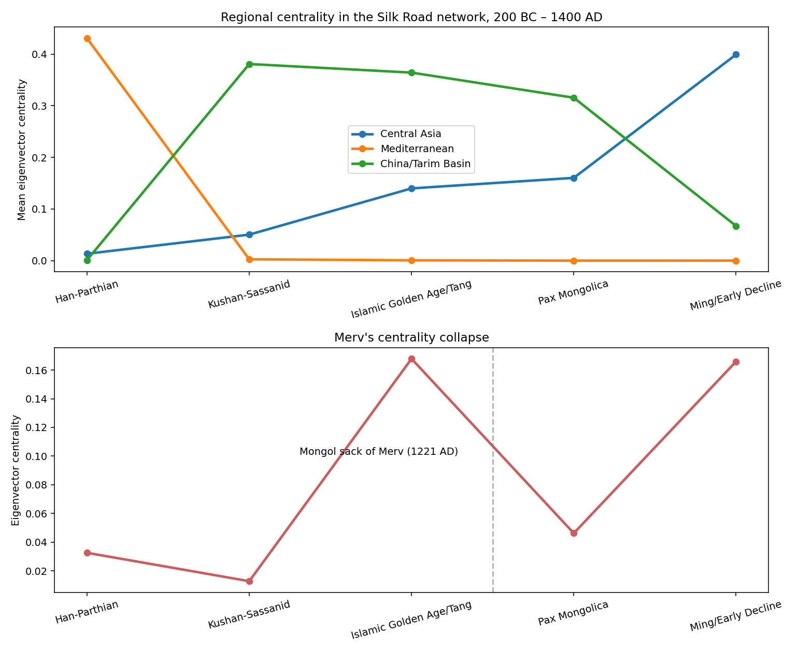
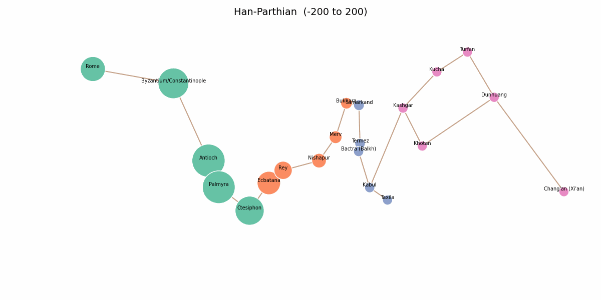

# The Rise and Fall of Central Asia's Silk Road

A network-analysis project on the ancient Silk Road: built from the
[Pleiades](https://pleiades.stoa.org) gazetteer, modeled as a temporal
weighted graph, and traced across five historical eras — from the
Han–Parthian period to the early Ming.

**Research question:** Was Central Asia's centrality in Afro-Eurasian trade
an inevitable, permanent fact — or a structural consequence of the land-route
era specifically, destined to fade once an alternative (maritime trade)
emerged?

## Results at a glance



Central Asia's eigenvector centrality rises steadily through the classical and
medieval land-route eras and collapses as maritime trade takes over — and the
pattern is sharpest at the level of individual cities. Merv, once called
"Queen of the World," tracks the whole arc in miniature.



*Animated map of the backbone network across five eras. Node size =
eigenvector centrality that era; node color = community membership that era.
Central Asia starts small and peripheral, grows steadily, and remains
structurally distinct (its own color) throughout.*

## Pipeline

The project runs as six notebooks, in order. Each one writes its results to
`data/` and its figures to `outputs/` for the next notebook to pick up.

| Notebook | What it does |
|---|---|
| [`nb1_eda.ipynb`](nb1_eda.ipynb) | EDA on the raw Pleiades data; filters the Mediterranean–Central Asian corridor; writes `nodes_corridor.csv`, `edges_corridor.csv`, `edges_trade_relevant.csv` |
| [`nb2_graph_construction.ipynb`](nb2_graph_construction.ipynb) | Turns the filtered tables into a `networkx` graph; finds that Pleiades' own connection table has no real long-distance trade-route structure |
| [`nb3_route_backbone.ipynb`](nb3_route_backbone.ipynb) | Builds the 21-node route backbone by hand from standard Silk Road historiography; computes static betweenness centrality |
| [`nb4_temporal_centrality.ipynb`](nb4_temporal_centrality.ipynb) | Adds time: five historical eras with historically-informed node-importance multipliers; computes weighted centrality per era |
| [`nb5_communities.ipynb`](nb5_communities.ipynb) | Runs Louvain community detection per era to find trade blocs and track their shifting orientation |
| [`nb6_final_writeup.ipynb`](nb6_final_writeup.ipynb) | Pulls everything into a single narrative, the animated map, and the final summary figure |

## Repo structure

```
├── nb1_eda.ipynb … nb6_final_writeup.ipynb   # the six notebooks, run in order
├── data/          # raw Pleiades CSVs + tables passed between notebooks
└── outputs/       # figures, the animated map, and the final summary
```

## Running it

```bash
pip install -r requirements.txt
jupyter notebook nb1_eda.ipynb   # then run nb1 → nb6 in order
```

The raw Pleiades extracts are expected in `data/`, so the notebooks run as-is
from the repo root. (On Kaggle, the path-config cells at the top of each
notebook switch to `/kaggle/input` automatically.)

## Data and licensing

- Raw data: [Pleiades: A Gazetteer of Past Places](https://pleiades.stoa.org),
  a community-built gazetteer of the ancient world. Check pleiades.stoa.org
  for current licensing terms (CC BY); attribution to the Pleiades project
  and its contributors is required.
- The route backbone and era multipliers are hand-curated by the author from
  standard Silk Road historiography — see Notebook 3 and Notebook 4 for the
  full sourcing notes inline.

## Limitations (stated plainly — see Notebook 6.4)

1. Pleiades covers the Mediterranean through Central Asia in detail but has
   zero records for Samarkand, Kashgar, Khotan, Turfan, Kucha, Dunhuang, or
   Chang'an; those 8 of 21 nodes use standard modern coordinates instead.
2. The route backbone is hand-curated, not data-derived — Pleiades'
   `connections` table contains no real long-distance trade-route edges.
3. Era importance multipliers are historically-informed but hand-assigned.
4. The backbone is a tree, which limits what betweenness centrality and
   community detection can express.
5. Small sample size: 21 nodes, by network-science standards.
